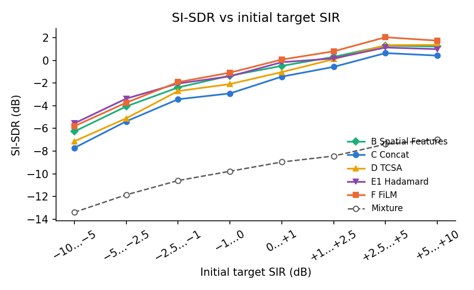
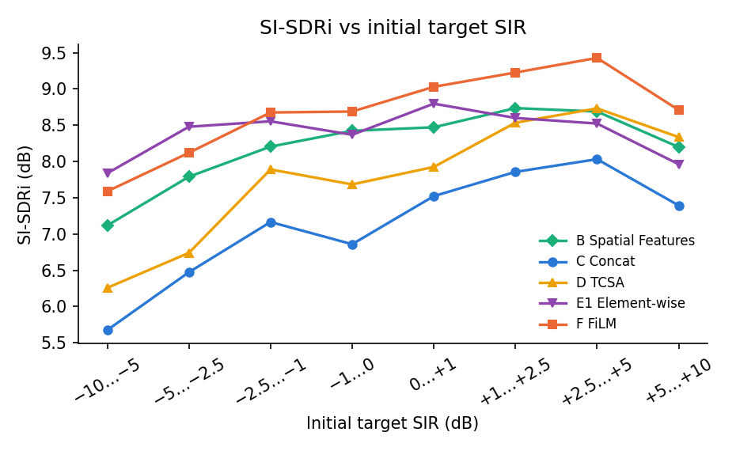
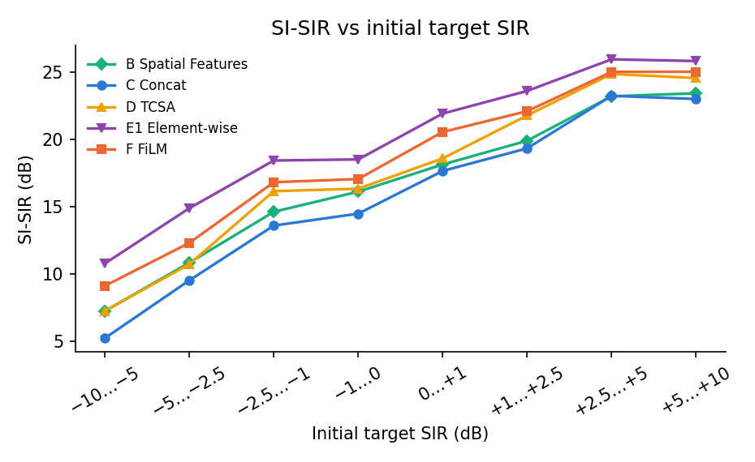
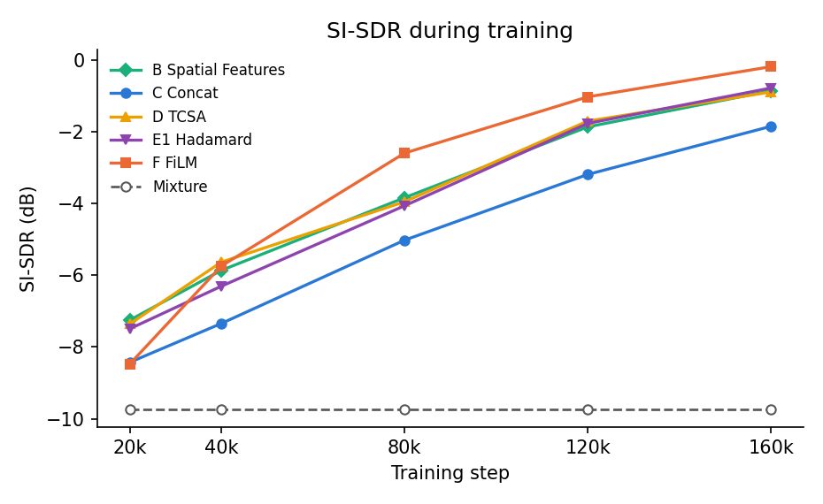
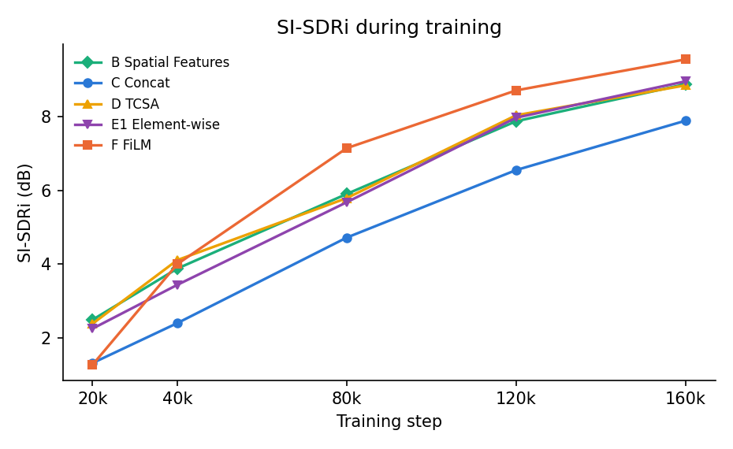
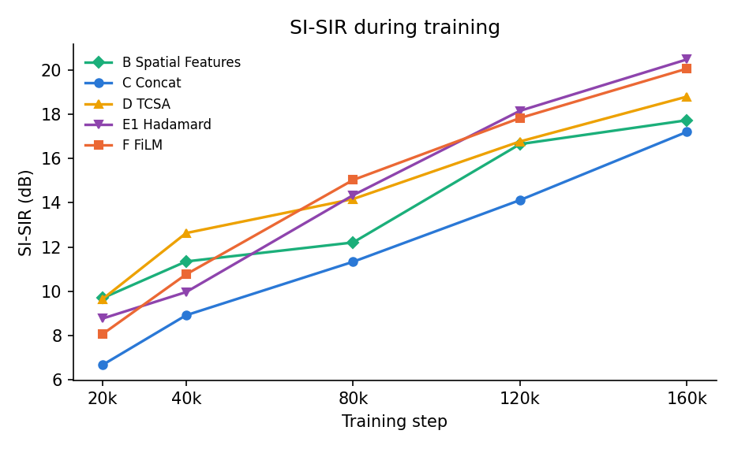

# Results

Generated from `site/data/*.json` by `tools/make_results.py`. Interactive version: https://avitalskop.github.io/binaural-exp2-demo/

- [`tables/overall.txt`](tables/overall.txt): overall results, valgrid, 160,000 steps.
- [`tables/training.txt`](tables/training.txt): training progression, valsep64, measured checkpoints.
- [`tables/initial_sir.txt`](tables/initial_sir.txt): performance vs initial target SIR, valgrid.
- [`plots/`](plots/): PNG and SVG of the two main plots for SI-SDR, SI-SDRi and SI-SIR.

